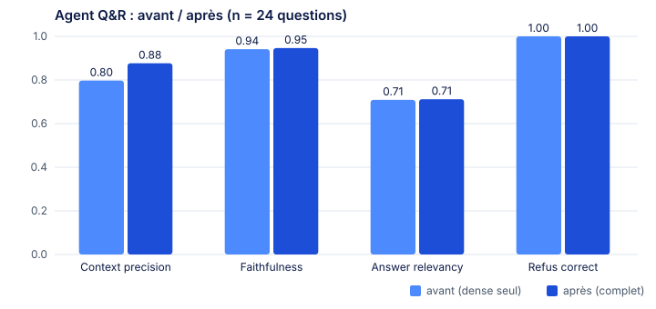

# B4 — Benchmark de l'agent Q&R : avant / après

Jeu d'évaluation C2 : **24 questions** évaluées par version. Configuration : questions = 24, juge = llm, answer relevancy = questions générées, modèles = bge-m3, bge-reranker-v2-m3, Qwen2.5-3B (local).

- **Avant** : recherche dense seule (bge-m3), sans reranker, sans Critic.
- **Après** : recherche hybride (bge-m3 + BM25, fusion RRF) + reranker bge-reranker-v2-m3 + agent Q&R (B3) + Critic (O3).

## Résultats

| Métrique | Avant | Après | Écart |
| --- | --- | --- | --- |
| Context precision | 0.80 | 0.88 | +0.08 ✅ |
| Faithfulness | 0.94 | 0.95 | +0.01 ✅ |
| Answer relevancy | 0.71 | 0.71 | +0.00 ✅ |
| Refus correct (hors cours) | 100 % | 100 % | +0 pts = |
| Faux refus (réponse dans le cours) | 6 % | 22 % | +17 pts ⚠ |
| Latence moyenne (s) | 49.78 | 105.47 | +55.70 ⚠ |
| Latence p95 (s) | 109.30 | 200.34 | +91.04 ⚠ |

## Par type de question (version après)

| Type | Questions | Context precision | Faithfulness | Taux de refus |
| --- | --- | --- | --- | --- |
| factuelle | 6 | 0.98 | 1.00 | 17 % |
| comprehension | 6 | 0.83 | 0.95 | 17 % |
| figure | 6 | 0.82 | 0.88 | 33 % |
| hors_cours | 6 | — | — | 100 % |

## Méthode

- **Context precision** (définition RAGAS avec référence) : moyenne des précisions@k aux rangs où une slide de référence de C2 apparaît parmi les 5 passages retrouvés. Calcul exact, sans LLM.
- **Faithfulness** (définition RAGAS) : part des affirmations de la réponse appuyées par les passages retrouvés, jugée par le LLM local (procédure du Critic O3). Non calculée pour un refus.
- **Answer relevancy** (définition RAGAS) : cosinus moyen (bge-m3) entre la question et 3 questions générées par le LLM local à partir de la réponse. Non calculée pour un refus.
- **Refus correct / faux refus** : réponse « L'information n'est pas dans le cours. » sur les questions hors cours / sur les questions dont la réponse est dans le cours.
- Règle v2 : la bibliothèque RAGAS appelle une API par défaut ; les métriques sont donc recalculées en local avec les mêmes définitions, le LLM de l'équipe (Qwen2.5-3B) et bge-m3.
- Limite : le juge de faithfulness est le même LLM que celui du Critic ; la version « après » est donc jugée avec la procédure qu'elle optimise. La context precision, elle, ne dépend d'aucun LLM.
